# new-AdDomain

[](LICENSE)
[](https://learn.microsoft.com/powershell/)
[](https://www.microsoft.com/windows-server)

Stands up a fresh Windows Server 2025 Active Directory forest and fills it with realistic-looking users, groups, computers, service accounts, GPOs, and a certificate authority. Built for labs, demos, red-team ranges, and SIEM testing, not for production.

This came out of a need to build a domain that looks lived-in for testing, and I did not want to click through the promotion wizard and then build users, groups, computers, etc. I wanted a solution that did not have any requirements not already built into Windows (Ansible, etc.). This does all that and more with PowerShell 5.1.

## What It Does

Two scripts run in sequence, split by the promotion reboot. Everything that has to happen before the box is a domain controller lives in script one. Everything that needs a running DC lives in script two.

1. **`New-ADForestDeployment.ps1`** (run as local Administrator, pre-domain). Runs pre-flight checks, sets a static IP on the wired NIC, installs AD DS / DNS / management tools, promotes the server as a new forest root DC, optionally registers a scheduled task to auto-run script two, then reboots.
2. **`Initialize-ADDirectory.ps1`** (run as Domain Administrator, post-promotion). Enables the AD Recycle Bin, deploys an Enterprise Root CA, sets DNS forwarders and time sync, validates the firewall, builds the OU tree, then populates users, groups (with nesting), computers, service accounts, GPOs, and password policy, and puts the DC in its own site with its own subnet. Finishes with functional tests and CSV/JSON artifacts.

Script two does not run on its own. The scheduled task uses an **at-logon** trigger, so directory population starts the next time an Administrator logs into the DC after the reboot. Script one prints a red banner reminding you of exactly that. If you skip `-CreateScheduledTask`, you will need to run script two by hand after the reboot.

Domain identity (`lab.test` / `LAB` out of the box), the password policy, the CA, the population mix and the rest are settings with shipped defaults. Every setting you can change without editing a script, and how, is in [OVERRIDE.md](OVERRIDE.md). To build a different domain for one build only, drop in a build profile, covered in the Build Profiles section below.

## What's New in 2.1

2.1 is about upgrades. Until now every setting lived in a tracked file, so an upgrade meant carrying your edits across by hand, and a `git pull` fought with them.

- **An override file.** Your settings go in one file that git ignores and no upgrade touches. Script one and script two both read it, a build profile still wins over it for one build, and a value you pass on the command line wins over both. [OVERRIDE.md](OVERRIDE.md) lists every setting, its default, what it takes and why it ships that way.
- **Your own CSV files** go next to it and replace the shipped file of the same name, so an edited `serviceaccounts.csv` survives the next upgrade too.
- **`Export-OverrideFile.ps1`** reads an older copy of this project, never runs it, and writes the settings you changed into the override file. [UPGRADE.md](UPGRADE.md) walks through it.
- **A version check.** Both scripts log their version, and stop before any change when `include\global-config.ps1` is older than the release they need. Before, nothing caught an old global-config.ps1 copied over a new one.
- **A clash gives way instead of stopping.** If the user-state percentages you set push the total past 100, the shipped ones you left alone are lowered with a warning. A `MinDA` above the shipped `MaxDA` raises it. Only your own values clashing with each other stop the run, and they stop it before anything is created.
- **SPNs that name another domain get a warning.** A literal SPN such as `MSSQLSvc/sql01.lab.local:1433` in a `lab.test` build is written as given, with a warning that shows the `{DomainName}` form.
- **Generated passwords hold both letter cases.** The check for an upper-case and a lower-case letter ignored case, so a password could have only one. Now both are required.
- **The minimum password length ships as 14, down from 15.** A domain's password policy holds at most 14 unless "Relax minimum password length limits" is turned on, and in a test build the DC logged event 16979 and enforced 14 anyway. A value from 15 to 128 still builds, with 14 and a warning. Anything above 128 stops the run before any change.
- **A changed default gets named.** When a release changes a shipped default and your run leaves that setting alone, both scripts log one INFO line with the old value, the new one and the override key that keeps the old one. In 2.1 that's the password length.
- **More than one NTP server.** Script two joined the `NtpServers` list with commas for `w32tm`. Microsoft's "Windows Time Service Tools and Settings" page says the peer list is space-delimited, so the peers are joined with spaces now. The shipped list has one server, so only an edited list was affected.
- **A CSV with a single row works.** Script two read each CSV file without making it a list, and on Windows PowerShell 5.1 a file with one row comes back as a single item with no row count. A replacement `offices.csv` holding one office stopped the run with "TOO FEW ROWS in offices.csv: found , need 1", and a `companies.csv` with one company would have stopped it later, after the CA, the OUs and the groups were created. Every CSV is read as a list now, so one row counts as one. The bug goes back to 1.0.

## What's Changed Since 1.0

1.0 built one forest, `lab.local`, unless you edited [include/global-config.ps1](include/global-config.ps1) by hand. 2.0 still builds the same lived-in domain in the same two steps. What changed is which forest you get, where the DC ends up in AD Sites and Services, and how loudly the scripts tell you a setting is wrong.

**Coming from 1.0 or 2.0?** [UPGRADE.md](UPGRADE.md) has the steps. From 2.1 on, your settings live in a file that upgrades leave alone, so this is the last upgrade that needs them moved.

### New in 2.0

- **Build profiles.** A small `include\build-profile.psd1` names the domain, the NetBIOS name, the functional levels, the minimum build and the site for one build, and global-config.ps1 stays untouched. Both scripts read it. See [Build Profiles](#build-profiles).
- **`Win2025` functional levels.** `ForestMode` and `DomainMode` take `WinThreshold` or `Win2025`. Once the AD DS role is installed, script one checks both names against what the installed `Install-ADDSForest` accepts, and a name it does not accept stops the run before promotion.
- **The DC lands in its own site.** Script two renames `Default-First-Site-Name` to your site name and gives it the subnet the DC's address sits in. See [The DC's site](#the-dcs-site).
- **SPNs follow the domain.** The SPNs in [config/serviceaccounts.csv](config/serviceaccounts.csv) use a `{DomainName}` placeholder, so they name hosts in whatever domain you build. See [Service account SPNs](#service-account-spns).
- **Six more functional tests.** The test results file now has fifteen rows. The new ones check the DC's site subnet, the requested subnet, the site name, site link membership, the site's locator record in DNS, and the service account SPNs.

### Changed behavior (read this if you used 1.0)

- **The default domain is `lab.test`, not `lab.local`.** If you still run a lab built by 1.0, see [An existing lab on lab.local](#an-existing-lab-on-lablocal).
- **The site step works differently.** 1.0 created a separate `Lab-HQ` site with a fixed `10.0.0.0/24` subnet and left the DC sitting in `Default-First-Site-Name`. 2.0 renames the DC's own site instead, and builds the subnet from the DC's address unless you name one that contains it.
- **A clash gets reported instead of skipped.** 1.0 skipped a site that already existed, with one INFO line. Now a taken site name, a DC already in another site, or a subnet that belongs to another site gets a WARN and a failed test row, and the build carries on.
- **Bad settings stop the run before anything changes.** A misspelled profile key or a functional level other than `WinThreshold` and `Win2025` stops script one before it changes the server. A misspelled SPN placeholder stops script two before it creates anything in the directory. The ERROR lines name the file and the setting at fault. You can no longer hit the old "`$forestName` must equal `$domainName`" error, because `$forestName` now follows `$domainName` on its own.
- **The minimum build is checked now.** `RequiredOSBuild` is the oldest Windows build script one will run on. In 1.0 a comment said not to set it below 14393 (Server 2016), but nothing enforced that. In 2.0 a value below 17763 (Server 2019) is raised to 17763 with a warning, and a value below 26100 is raised to 26100 when either functional level is `Win2025`, since that level needs Server 2025. The shipped value is still 26100, so out of the box only Server 2025 passes. Nothing below 26100 has been tested. Server 2019 and 2022 are allowed because the lab is meant to cover them, but whether a build on either one works is still a guess.

### Under the hood

- **CSV files are written as UTF-8 with a byte order mark.** On Windows PowerShell 5.1, 1.0 wrote `ad-deploy-errors.csv`, `users-<timestamp>.csv` and `test-results-<timestamp>.csv` in the default encoding, which turns a surname like Müller into `M?ller`.
- **global-config.ps1 is laid out in three parts.** The base values come first, then the profile load and its checks, then the values derived from the domain, such as the OU paths. Each base value starts out empty, so a deleted line shows up as an empty setting instead of quietly picking up a variable of the same name from whatever ran the file.

## Screenshots

### Script one - `New-ADForestDeployment.ps1`

1. **Feature installation.** Installing AD DS, DNS, and management tools before promotion.

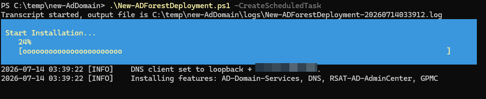

2. **Forest promotion begins.** `Install-ADDSForest` validating prerequisites for the new forest root domain.

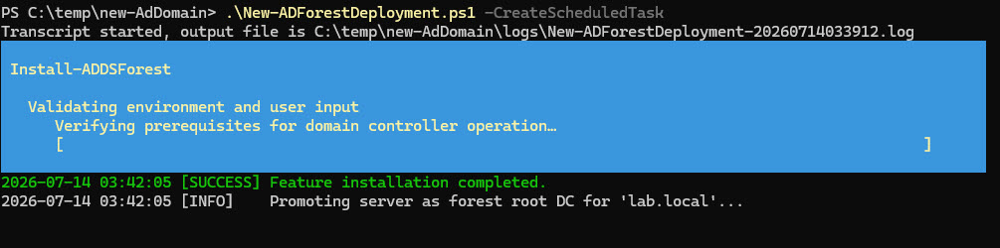

3. **Promotion in progress.** The DNS delegation warning is expected for a new forest root with no parent zone. No action needed.

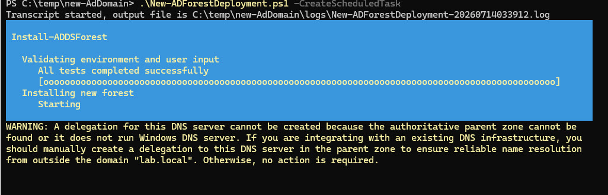

### Script two - `Initialize-ADDirectory.ps1`

4. **Post-promotion pre-flight.** Confirms core AD services are running, saves the dcdiag/repadmin reports, and enables the Recycle Bin.

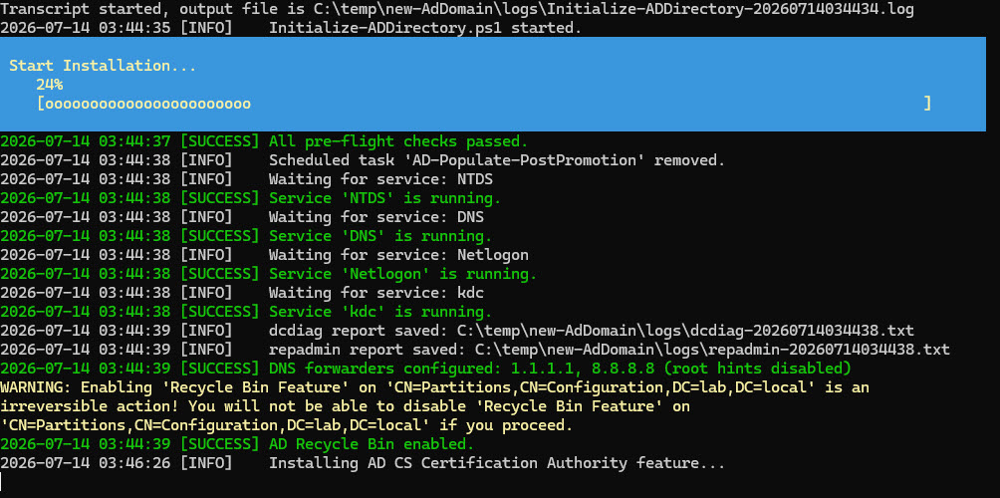

5. **CA, firewall check, and OU structure.** Enterprise Root CA deployed, then `Test-FirewallRules` validates DC/CA ports. The WARN lines are informational, since the function only validates and does not create rules. CSV validation and OU creation follow.

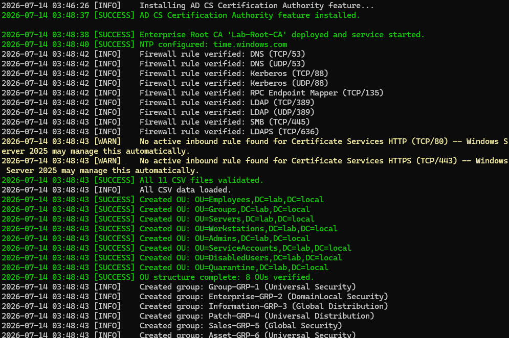

6. **Populating the directory.** Group creation finishes at 50, then user creation runs toward the configured count.

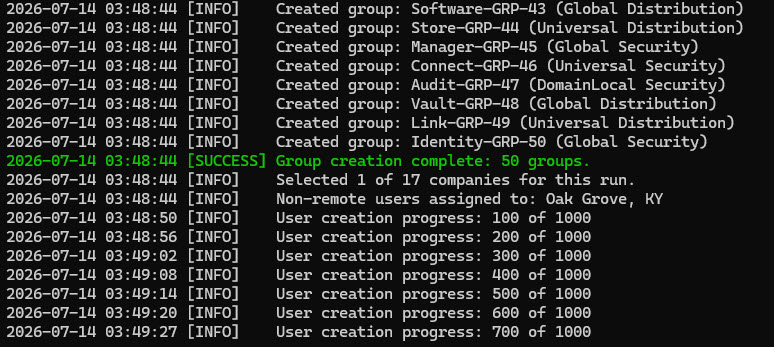

7. **Wrap-up and functional tests.** Service accounts, GPOs, password policy, and site topology configured. Functional tests confirm the build.

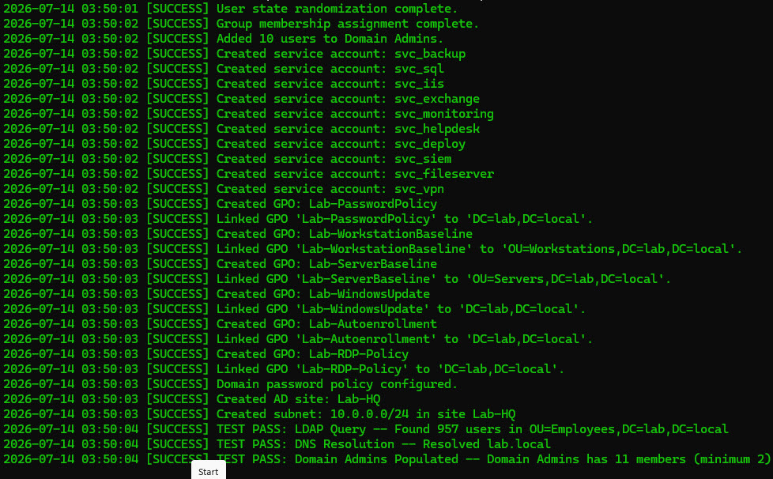

### Result, in Active Directory Users and Computers

8. **Employees OU.** Users created by script two.

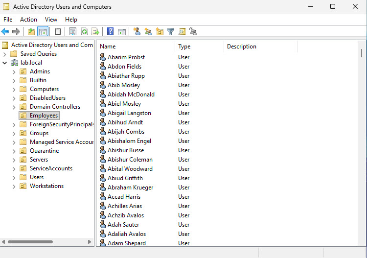

9. **Groups OU.** A mix of security and distribution groups.

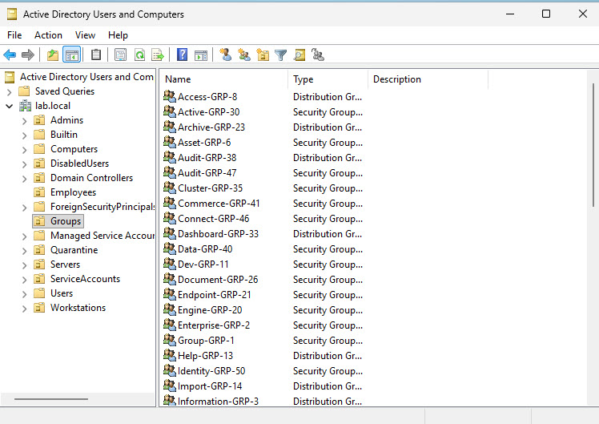

10. **Nested group membership.** A group nested inside another group, alongside individual user members.

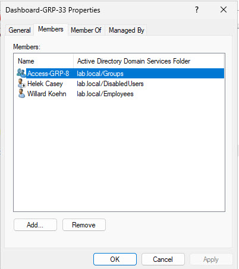

11. **DisabledUsers OU.** Users moved here by the user-state randomization pass.

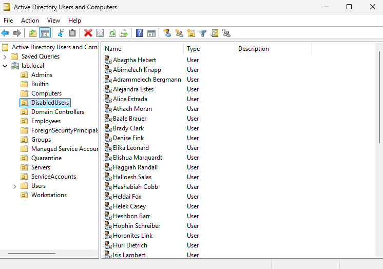

### Artifacts

12. **Functional test results.** `test-results-<timestamp>.csv`, one PASS/FAIL row per check, covering the LDAP query, DNS resolution, Domain Admins membership, CA status, and more.

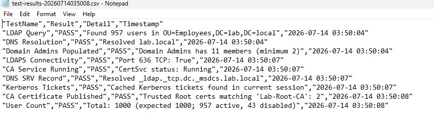

13. **User export.** `users-<timestamp>.csv`. As noted below, this file carries the beautiful plaintext password generated for each user. This is a lab, so this should be OK, but treat it accordingly.

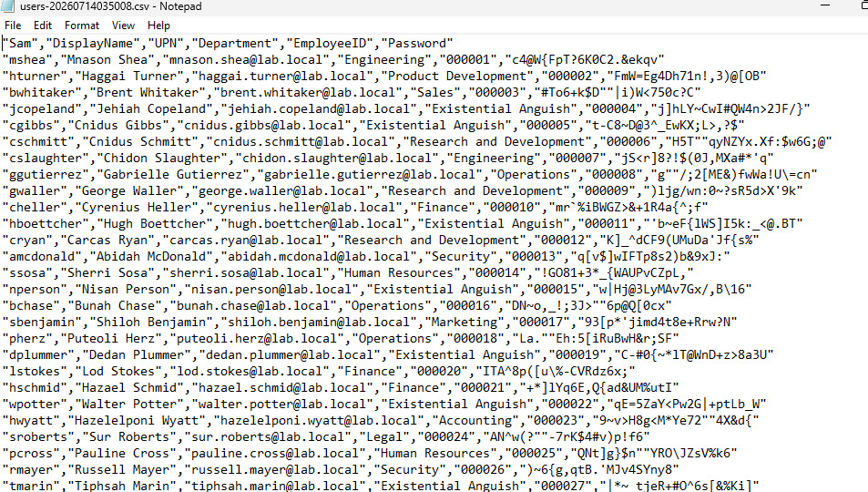

## Requirements

- **Windows Server 2019, 2022 or 2025** (build 17763 at the lowest), at the `WinThreshold` or `Win2025` functional level. `Win2025` needs Server 2025 domain controllers. Out of the box script one wants build 26100 and refuses anything older, because Server 2025 is the only release I have tested. To run on Server 2019 or 2022, set `RequiredOSBuild` in a build profile. I have only tested on Server 2025.
- **PowerShell 5.1.** PowerShell 7 is not supported or tested. Without extra work it will not run, because both scripts depend on Windows PowerShell only modules. The scheduled task and both scripts assume `powershell.exe`.
- **Local Administrator** rights for script one, and **Domain Administrator** rights for script two.
- **A clean server.** No existing AD DS role, no AD CS role, not already domain-joined, and the target domain name must not already resolve in DNS. Script one checks all of this and stops if any of it is true.

AD CS is deliberately left out of script one. `Install-ADDSForest` will not promote a server that already has Certificate Server installed, so the CA role goes in post-promotion inside script two.

The RSAT AD tools and GPMC that script two needs are installed by script one during the feature step, so you do not have to add them yourself.

## Tested On

- **Windows Server 2025 (build 26100).** Promotion through full directory population, run end to end on live VMs. 2.0 was run with no profile, with a profile at the `WinThreshold` level, with a profile at the `Win2025` level, and with profiles built to clash with an existing site and subnet.

The unattended path (`-NonInteractive` with supplied network parameters) exists so an outside orchestrator can drive script one over VMware guest operations without a console to prompt at. That orchestration script is not part of this repo. I have another project that does this.

## Quick Start

Clone the repository:

```powershell
git clone https://github.com/0x44616e69656c/new-AdDomain.git
cd new-AdDomain
```

Downloaded the zip instead? Windows blocks files downloaded from the internet by default, and a `RemoteSigned` execution policy won't run a blocked script. Look the files over, then unblock them from inside the extracted folder:

```powershell
Get-ChildItem -Recurse -File | Unblock-File
```

If you want something other than `lab.test` / `LAB`, set `DomainName` and `NetBIOSName` in the override file ([OVERRIDE.md](OVERRIDE.md) shows how) or add a build profile (see Build Profiles). Then run script one from an elevated prompt on a clean Server 2025 box:

```powershell
.\New-ADForestDeployment.ps1 -CreateScheduledTask
```

It promotes the DC and reboots. After the reboot, log in as Administrator. The scheduled task fires and script two builds out the directory. Expect a few minutes for promotion and a bit longer for AD object population.

Prefer to keep the two steps separate? Drop `-CreateScheduledTask`, let the box reboot, then run script two yourself:

```powershell
.\Initialize-ADDirectory.ps1
```

## Full Example

Unattended promotion where the adapter came up on DHCP and you want to pin a static address without any prompts:

```powershell
.\New-ADForestDeployment.ps1 -CreateScheduledTask -NonInteractive `
    -StaticIpAddress '192.168.1.50' -PrefixLength 24 -DefaultGateway '192.168.1.1'
```

A smaller, reproducible population with computer objects included:

```powershell
.\Initialize-ADDirectory.ps1 -UserCount 500 -GroupCount 25 -ComputerCount 100 -RandomSeed 42
```

`-RandomSeed` fixes the randomness so two runs produce the same directory. Handy when you need a lab that rebuilds identically.

## Parameters

### `New-ADForestDeployment.ps1`

| Parameter | Default | Notes |
|---|---|---|
| `-CreateScheduledTask` | switch | Registers the at-logon task so script two auto-runs after the reboot. |
| `-NonInteractive` | switch | Never prompts. Any code path that would call `Read-Host` throws a clear error instead. For console-less unattended runs. |
| `-StaticIpAddress` | none | Static IP to apply when the selected adapter is found on DHCP. Required with `-NonInteractive` in that case. |
| `-PrefixLength` | none | Subnet prefix length, 1-32. Required alongside `-StaticIpAddress` under `-NonInteractive`. |
| `-DefaultGateway` | none | Default gateway. Required alongside `-StaticIpAddress` under `-NonInteractive`. |
| `-AdapterName` | none | Selects the wired NIC by name when more than one eligible adapter is present. Required under `-NonInteractive` when the choice is ambiguous. |

### `Initialize-ADDirectory.ps1`

Each default below can also be changed in the override file, and a value you pass on the command line wins over it. [OVERRIDE.md](OVERRIDE.md) has the keys.

| Parameter | Default | Notes |
|---|---|---|
| `-UserCount` | `1000` | Number of users to create. |
| `-GroupCount` | `50` | Number of groups to create before nesting. |
| `-ComputerCount` | `0` | Computer objects to create. `0` skips computer creation. |
| `-PasswordLength` | `20` | Generated password length, 4-94. |
| `-MinGroupMembers` | `2` | Minimum members assigned to each group. |
| `-MaxGroupMembers` | `10` | Maximum members assigned to each group. |
| `-MinDA` | `2` | Minimum users added to Domain Admins (random within range). |
| `-MaxDA` | `10` | Maximum users added to Domain Admins. |
| `-MaxGroupNestingDepth` | `3` | Deepest group-in-group nesting. |
| `-RandomSeed` | `0` | Seeds the RNG for a reproducible run. `0` means no seed (fresh randomness each run). |

Domain name, NetBIOS name, CA settings, password policy, the user-state percentages and the rest are configuration, not parameters. [OVERRIDE.md](OVERRIDE.md) lists each one and how to change it. A build profile can override the domain, the functional levels, the minimum build and the site for one build.

## Build Profiles

A build profile picks the forest for one build, without touching your standing settings. It is a PowerShell data file at `include\build-profile.psd1`. Both scripts read it when it is there, and it wins over the override file for the keys it sets. The file name is in `.gitignore`, so a profile you drop in for one build never gets committed by accident.

```powershell
@{
    DomainName      = 'corp.example.test'
    NetBIOSName     = 'CORP'
    PrimarySiteName = 'Corp-HQ'
    PrimarySubnet   = 'Auto'
}
```

The keys a profile takes, what each accepts, what happens to a key you leave out or leave empty, and the keys it refuses are in the [Build profile](OVERRIDE.md#build-profile) part of OVERRIDE.md. Every log line names where its value came from, so you know which file to fix. If build-lab drives your builds, its `-ProfilePath` parameter picks the profile for a run, and build-lab's own README covers it.

### Service account SPNs

The SPNs in [config/serviceaccounts.csv](config/serviceaccounts.csv) name their hosts with a `{DomainName}` placeholder, for example `MSSQLSvc/sql01.{DomainName}:1433`. Script two swaps in the build's domain when it creates the account. An SPN you write without the placeholder is kept exactly as written. A misspelled placeholder like `{Domain}` stops script two before it creates anything in the directory, and the error names the CSV row.

### An existing lab on lab.local

The default domain moved from `lab.local` to `lab.test`. RFC 6762 reserves `.local` for multicast DNS, and RFC 2606 reserves `.test` for testing. If you still run a lab built on the old name, this profile keeps the scripts pointed at it:

```powershell
@{ DomainName = 'lab.local'; NetBIOSName = 'LAB' }
```

You will get a warning about `.local`. That is the build telling you something you already know.

### The DC's site

Script two renames `Default-First-Site-Name` to the requested site name (`Lab-HQ` unless you say otherwise), so the DC stays in the default site link. With `PrimarySubnet` at `Auto` it creates the subnet the DC's own address sits in, which is the only value that is right on every host. An explicit subnet is used when it contains the DC's address. If the name is already taken, the DC already sits in another site, or the subnet belongs to another site, the build carries on. It logs a warning and fails the matching test row instead.

## Logs

Logs go to `logs\` under the project folder.

Both scripts produce:

- `<ScriptName>-<timestamp>.log` - the full PowerShell transcript for after-the-fact diagnosis.
- `ad-deploy-errors.csv` - structured `WARN`/`ERROR` rows shared by both scripts, so failures survive across runs and can be queried without grepping transcripts. Columns: `Timestamp,Level,Script,Message`. Import with `Import-Csv`.

Script two also writes two post-promotion diagnostic reports:

- `dcdiag-<timestamp>.txt` - output of `dcdiag /v`.
- `repadmin-<timestamp>.txt` - output of `repadmin /replsummary`.

`Export-OverrideFile.ps1` writes `Export-OverrideFile_<timestamp>.csv` there too, one row per setting it read, with secret values shown as `<set>`.

If you file a bug, include these.

## Artifacts

Script two writes a snapshot of what it built to `artifacts\`:

- `users-<timestamp>.csv` and `users-<timestamp>.json` - every user created, with a subset of attributes. **This includes passwords for users.**
- `test-results-<timestamp>.csv` - pass/fail rows from the functional test pass.

Both CSV files are written as UTF-8 with a byte order mark, so accented names come through intact.

## Configuration Notes

Every setting, its default and how to change it is in [OVERRIDE.md](OVERRIDE.md). The text files the users, groups and service accounts are built from (names, departments and so on) are in the [config](config) directory, and OVERRIDE.md says how to replace one with your own.

A few choices in [include/global-config.ps1](include/global-config.ps1) are deliberate. Do not "fix" them unless you understand what you are doing and don't report bugs if changes break things:

- **`$usersOU` is `OU=Employees`, not `OU=Users`.** An OU named `Users` collides with the built-in `CN=Users` container at the domain root.
- **`$forestName` always equals `$domainName`.** This builds a new forest root domain, so the two are the same, and the config sets one from the other.
- **The DSRM password is hardcoded in script one.** It is a lab tool. The variable is named `$dsrmPwDontDoThisInProd` so nobody mistakes the intent. You can change it with the `DsrmPassword` setting in the override file, but it's a lab.
- **Enterprise CA database and log share one directory.** Fine for a lab, not what you would do in production.

## Known Limitations

- **Lab and demo only.** Hardcoded DSRM credential, a self-signed-style Enterprise CA, and a wide-open functional model. This is not a hardened build and is not meant to be. A DSRM password you put in the override file sits there in plain text, and when build-lab drives the build it copies the whole project folder, override file included, onto the DC, where it stays at `C:\temp\new-AdDomain` after the build.
- **New forest root only.** It does not join an existing forest, add a child domain, or add a replica DC.
- **Single DC, single site.** The DC's site is renamed and given one subnet. No replication topology beyond that.
- **Population is only partly idempotent.** OUs, service accounts, computer objects, and GPOs are skipped if they already exist, and the site step keeps whatever site the DC already sits in, but re-running script two adds a fresh batch of randomly generated users and groups and re-rolls their memberships. Start from a clean promotion for a predictable result.

## Troubleshooting

**"ADCS-Cert-Authority is already installed."** - `Install-ADDSForest` will not promote a server with the CA role present. Remove AD CS, then re-run script one. The CA is installed later by script two.

**"DNS name '...' already resolves."** - The target domain name already answers in DNS, which usually means a conflicting zone or a prior half-built attempt. Clear it before re-running.

**Directory never populated after the reboot.** - The scheduled task triggers at Administrator logon, not at boot. Log into the DC as Administrator. If you never passed `-CreateScheduledTask`, run `Initialize-ADDirectory.ps1` by hand.

**Script one hangs with no output on an unattended VM.** - A prompt is waiting on a console that is not there. Re-run with `-NonInteractive` and supply `-StaticIpAddress`, `-PrefixLength`, `-DefaultGateway`, and `-AdapterName` as needed.

**"Stopping before any change: the build profile check failed."** - The ERROR lines just above it name the file (the override file, the build profile or global-config.ps1) and the key or variable at fault. Fix that value and run the script again.

**"... needs include\global-config.ps1 ... or later, and the one loaded has no version"** - An `include\global-config.ps1` from an older release was put back over this one. Restore this release's copy, and move your settings into the override file as [UPGRADE.md](UPGRADE.md) shows.

**"Override file '...': unknown key"** - A key in your override file is misspelled, or belongs to another lab project, which the line names. [OVERRIDE.md](OVERRIDE.md) lists the keys.

## Contact

- Mastodon: @daniel@infosec.exchange
- Email: 0x44616e69656c {AT} [not-this]danielowen[.]com
- LinkedIn: https://www.linkedin.com/in/danielowen/
- Web: https://danielowen.com

## Contributing

Bug reports and pull requests are welcome. This project accepts code changes through the fork and pull request model. See [CONTRIBUTING.md](CONTRIBUTING.md) for how to file a bug and the pull request requirements.

## License

Released under the [MIT License](LICENSE). You are free to use, copy, modify, and distribute this software, including for commercial purposes, provided the copyright notice and license text are retained. The software is provided "as is", without warranty of any kind.
